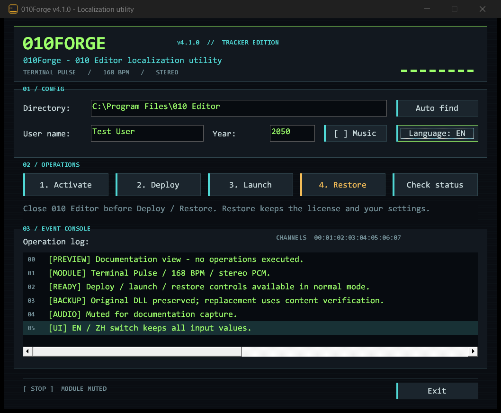
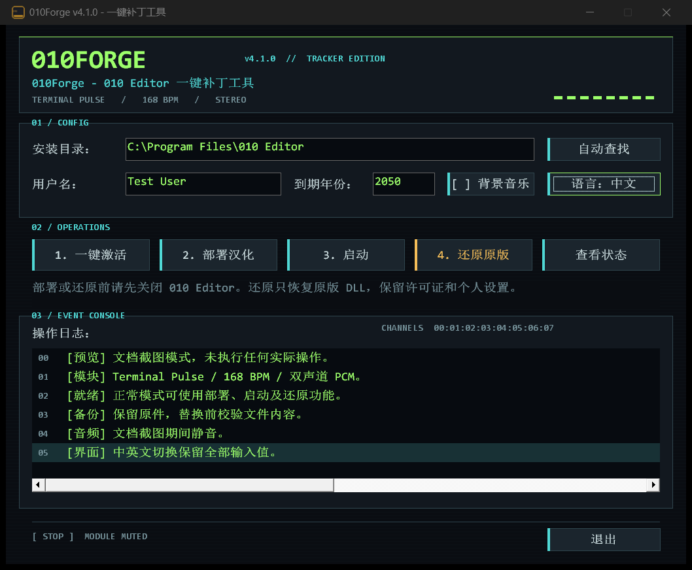
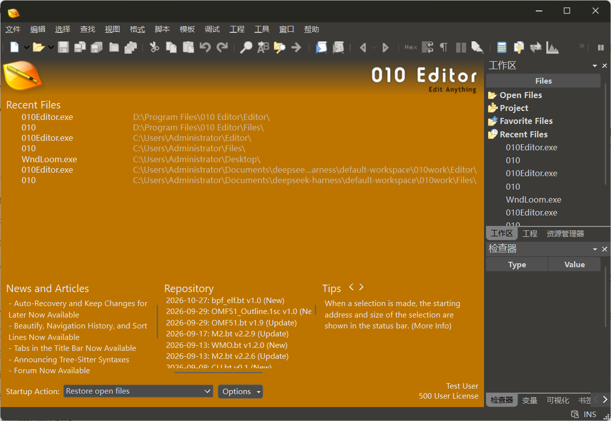
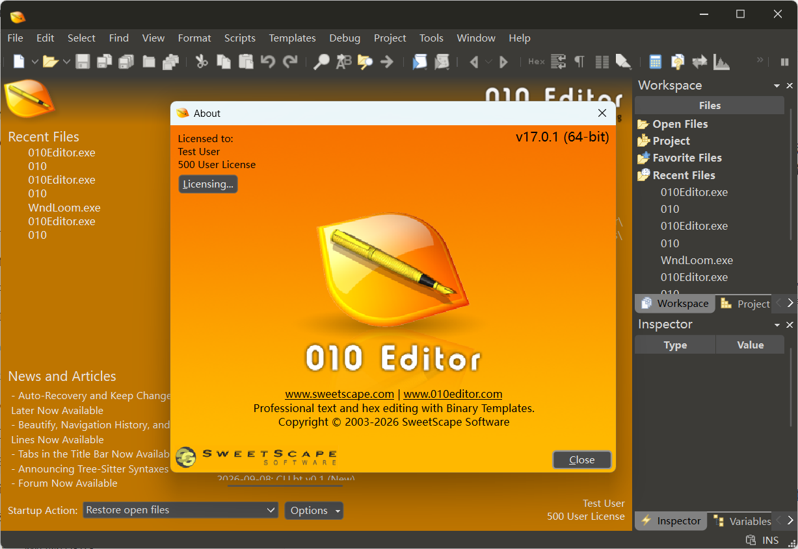

# 010Forge v4.1

**A single-file Win32 GUI utility for 010 Editor 17.0.1 x64.**

[简体中文](README.md) | **English**

## What changed in v4.1

- **Deploy installs automatic localization**: validates the supported installation, backs up the original `quazip.dll`, then installs the embedded proxy. Desktop shortcuts, file associations and direct EXE launches use the same installation.
- **Restore original**: verifies `quazip_orig.dll` before restoring. The verified backup, existing license and personal settings are preserved. Missing or non-PE damaged current DLLs can also be recovered.
- **One EXE to distribute**: the proxy DLL, icon and original background music are embedded. No extra `zhcn.dll` or launcher is required.
- **Music**: the original B *Terminal Pulse* score and voices, accelerated from 148 to **168 BPM**, with an **11.43-second stereo loop**. Toggle playback at any time; it stops on exit.
- **Tracker skin**: dark scanlines, monospaced type, phosphor-green logs, cyan pixel borders and an amber Restore button. Both languages and five equally sized action buttons remain available.
- **Aligned bilingual controls**: Chinese Windows UI languages select simplified Chinese; other languages select English. Manual switching preserves the entered path, name and year. Five action buttons use equal sizes and stable control IDs.
- **Verified file transactions**: SHA-256 content identity, staged writes and atomic replacement. No size-only detection, delete-first restore, or forced process termination.
- **Source-built embedded payload**: CMake builds the proxy before embedding it, and recompiles resources when the DLL, WAV or icon changes. Build outputs remain outside the source tree.

## Preview

The utility images show the current real EN/ZH windows rendered on a private desktop using `--preview`. The capture mode does not examine a real installation or license, deploy files, or play audio. The 010 Editor images remain earlier observed application results.

### English utility / Tracker skin



### Chinese utility / Tracker skin



### Localized 010 Editor





## Usage

1. Run `010Forge.exe`. Use **Auto find** or enter the installation directory manually.
2. **1. Activate**: the existing name/year operation verifies locally before writing registry values. Verify the final state inside 010 Editor.
3. **2. Deploy Chinese UI**: save work and close 010 Editor first. The original is retained as `quazip_orig.dll`. Repeating deployment is idempotent; the original backup is never replaced with the proxy.
4. **3. Launch**: starts `010Editor.exe` directly. Existing desktop shortcuts work too; no remote-thread injector or resident launcher is needed.
5. **4. Restore original**: close 010 Editor, then click Restore. Only `quazip.dll` is restored; the license and settings are untouched. Already-original installations remain unchanged.
6. **Check status**: shows file/backup verification results and the stored name. Process creation is not presented as proof of a verified localized UI.
7. **Music** toggles playback (`[x]` playing / `[ ]` muted); **Language** switches the utility UI.

Locked files produce an error asking you to save and close the application. No `taskkill /F` is used. If the installation directory is not writable, manually run this utility as administrator. The old `.bat` deployment scripts were removed so they cannot bypass verification and transactional restore.

## Is zhcn.dll still needed?

**Not for normal use.** The GUI embeds only the `quazip.dll` proxy. Its 253 forwarded exports resolve to the original backup. Both DLL targets share the localization source in `zhcn/`; developers may opt into a standalone fallback using `-DFORGE_BUILD_STANDALONE_ZHCN=ON`.

## Compatibility

The verified target is **Windows x64 / 010 Editor 17.0.1 x64** only:

| File | SHA-256 |
|---|---|
| `010Editor.exe` | `865f43ab9b0cb7fa3ce385ed82b8b11ab4ea36fb7054cf70cb136a5f4f5b0a7d` |
| Original `quazip.dll` | `a6d829e0457ebc374e57c05cef02192b5031b1564361313e7ae86970fb8d3b20` |

A matching version label with different bytes does not authorize deployment. Unknown or conflicting DLLs/backups stop replacement. Only explicitly pinned older proxies are recognized. Future application versions have not been verified by this release.

Translation covers the main menu and selected dialogs/static text, **not 100% of the application**. Downloaded template descriptions, user content and some dynamic labels can remain English.

## Build and test

Requirements: Windows 10/11 x64, Visual Studio 2022 Desktop C++ tools and Windows SDK, CMake 3.21+. From the **x64 Native Tools Command Prompt for VS 2022**:

```console
cmake -S . -B build -G "NMake Makefiles" -DCMAKE_BUILD_TYPE=Release -DBUILD_TESTING=ON
cmake --build build
ctest --test-dir build --output-on-failure
cmake --install build --prefix dist
```

Output: `build/bin/010Forge.exe`. The installed package contains the EXE, both READMEs, changelog and `images/`. The EXE is a single distributable; deployment writes a proxy into the selected application directory. The MSVC CRT is statically linked; 010 Editor still uses its own installed Qt runtime.

```text
CMakeLists.txt                 # GUI, proxy and resource dependency graph
main.cpp / ui_text.h           # Win32 GUI and stable bilingual control IDs
deployment.cpp / deployment.h  # Verified file transactions
license.cpp / license.h        # Existing codec module
hijack/quazip.def              # 253 API export forwarders
zhcn/                         # Shared localization code and dictionary
resources/                    # Icon, original WAV and manifest (no built DLLs)
cmake/GenerateResource.cmake   # Configuration-specific generated RC
tests/                        # Fake-file, resource and language regression tests
.github/workflows/release.yml  # CI and tag publishing
```

The proxy is built into `build/resources/quazip.dll`; multi-config builds isolate their Debug/Release payloads. No build products are written to source `resources/`, and no committed prebuilt DLL is used.

Automated tests use disposable fixtures only. They do not execute 010 Editor, change registry values, or play audio. Coverage includes install/repeat/restore, recovery, invalid backups, sharing locks, same-size different bytes, byte-for-byte embedded DLL equality, audio/icon/manifest checks, bilingual labels and existing codec regression. Passing these tests is distinct from a manual desktop acceptance test.

### Regenerate music

The original WAV is committed, so ordinary CMake/CI builds require no Python. To regenerate it:

```console
python gen_assets.py --music-only
```

Regenerating the music requires NumPy and uses a fixed seed. Normal CMake/CI builds embed the generated WAV directly and need no Python. Pillow is needed only to regenerate the icon.

### Regenerate documentation screenshots

```console
cmake -S . -B build -DFORGE_BUILD_UI_CAPTURE=ON
cmake --build build
build\bin\forge_capture_ui.exe build\bin\010Forge.exe dist\ui-captures
```

The helper creates a private desktop and starts only the utility's `--preview --lang=en/zh` windows. `PrintWindow` captures BMPs without copying the user's screen. Convert those BMPs to PNG for `images/gui-tool-en.png` and `images/gui-tool-zh.png`. Checks include contained controls, an aligned action row and input-preserving language switching.

## GitHub Actions and v4.1

Pushes to `main`, PRs and manual runs build, test and upload an Actions artifact without publishing a Release. A pushed `v*` tag runs the same tests, then publishes a ZIP and SHA-256 file.

```console
git push origin main
git tag -a v4.1 -m "010Forge v4.1"
git push origin v4.1
```

Use a fresh version tag instead of overwriting published tags. ZIPs include the EXE, both READMEs, CHANGELOG and all linked screenshots for offline viewing.
