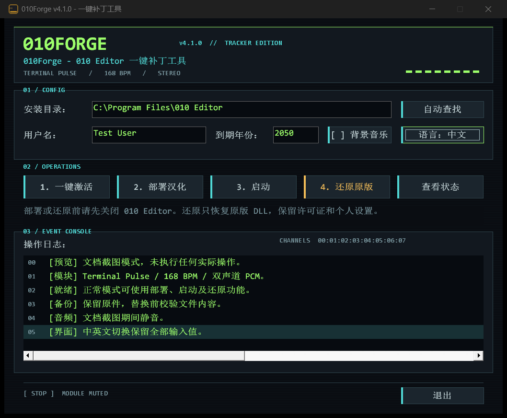
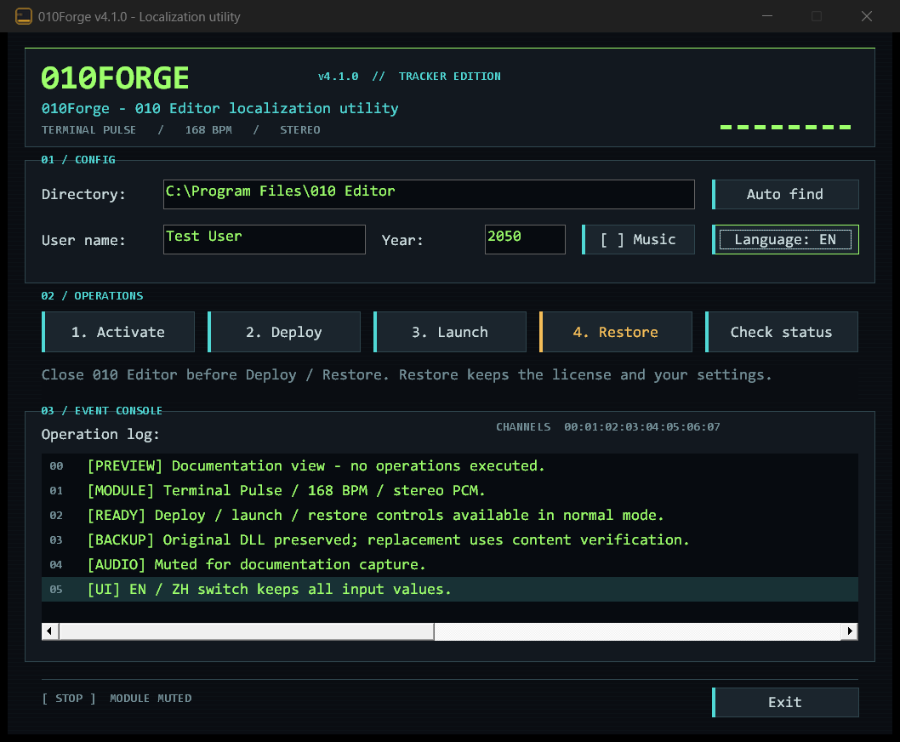
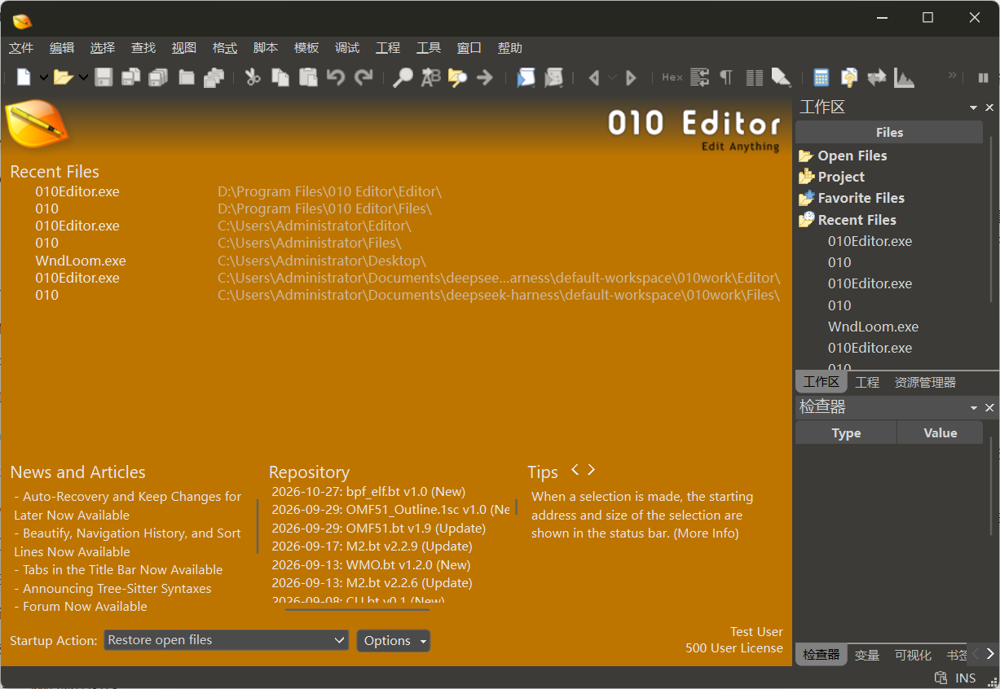
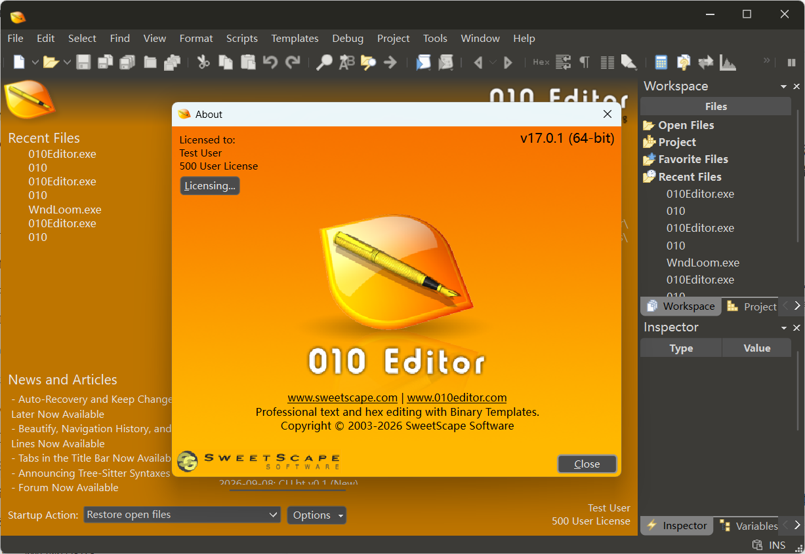

# 010Forge v4.1

**010 Editor 17.0.1 x64 的单文件 Win32 GUI 工具。**

**简体中文** | [English](README.en.md)

## v4.1 改动

- **「部署汉化」真正安装自动加载代理**：校验安装版本 → 备份原 `quazip.dll` → 安装 EXE 内嵌的代理。从桌面快捷方式、文件关联或原 EXE 启动均加载汉化。
- **「还原原版」**：校验 `quazip_orig.dll`，恢复原版 DLL，保留备份、现有许可证和个人设置。当前 DLL 缺失或非 PE 损坏时也有恢复路径。
- **单个 EXE 分发**：内嵌 quazip 代理、图标、原创背景音乐。无需额外带 `zhcn.dll` 或启动器。
- **背景音乐**：采用原 B《Terminal Pulse》编曲和音色，148 → **168 BPM**，约 **11.43 秒立体声循环**。右上角「背景音乐」按钮可随时开关，退出即停止。
- **Tracker 界面**：深色扫描线背景、等宽字体、荧绿色终端日志、青色像素边框和琥珀色还原按钮，保留中英文切换与五个等宽功能按钮。
- **GUI 对齐与双语**：按系统界面语言选择简体中文或英文，提供手动切换；切换时保留用户名、路径和年份。五个功能按钮等宽对齐。
- **可靠文件事务**：SHA-256 内容校验，先写临时文件再替换，不按文件大小猜测版本，不先删除当前 DLL，不强制结束进程。
- **源码构建**：CMake 自动编译代理 DLL 再嵌入 EXE；代理、图标或音乐变化会触发资源重编译。所有构建产物留在构建目录。

## 界面预览

工具截图是当前构建的真实中英文窗口：在隔离桌面通过 `--preview` 渲染和截取，不访问真实安装或许可证，也不执行部署、播放音乐。010 Editor 本体效果图仍保留已有实测截图。

### 工具界面（简体中文 / Tracker 主题）



### Tool interface (English / Tracker skin)



### 010 Editor 汉化效果



### 已存储的授权状态示例



## 使用

1. 运行 `010Forge.exe`，点 **自动查找**，或手动填写安装目录。
2. **1. 一键激活**：现有名称/年份操作会先做本地校验，通过后写入注册表；最终状态在 010 Editor 内核验。
3. **2. 部署汉化**：先保存工作并关闭 010 Editor，再点击部署。首次部署保留原件为 `quazip_orig.dll`。重复点击是幂等操作，原件备份不会被代理覆盖。
4. **3. 启动**：直接启动该目录的 `010Editor.exe`；也可继续使用原桌面快捷方式。无需远程线程注入或常驻启动器。
5. **4. 还原原版**：关闭 010 Editor 后点击。只还原 `quazip.dll`，不删除许可证和配置文件。已是原版时不重复修改。
6. **查看状态**：显示代理/备份的内容校验结果和已存储名称；不把“进程已创建”误报为“界面已验证”。
7. **背景音乐**按钮开关音乐（`[x]` 表示播放、`[ ]` 表示静音）；**语言**按钮切换工具的中英文界面。

文件占用时会提示保存并关闭软件，不会使用 `taskkill /F`。安装目录写入权限不足时，可手动以管理员身份运行。旧的 `.bat` 部署脚本已移除，避免绕过 GUI 的校验和还原事务。

## zhcn.dll 还有用吗？

**正常使用不需要。** GUI 只嵌入 `quazip.dll` 代理，代理包含汉化代码，转发 253 个 API 到原件备份。`zhcn/` 现在是共享汉化源码目录，而非必须额外部署的 DLL。需要独立备用 DLL 的开发者可配置 `-DFORGE_BUILD_STANDALONE_ZHCN=ON`。

## 兼容性

当前验证对象仅为 **Windows x64 / 010 Editor 17.0.1 x64**：

| 文件 | SHA-256 |
|---|---|
| `010Editor.exe` | `865f43ab9b0cb7fa3ce385ed82b8b11ab4ea36fb7054cf70cb136a5f4f5b0a7d` |
| 原版 `quazip.dll` | `a6d829e0457ebc374e57c05cef02192b5031b1564361313e7ae86970fb8d3b20` |

版本名称相同但二进制不同也会停止部署，避免错误的 IAT/字符串地址导致崩溃。后续 010 Editor 版本没有在本次发布中验证。旧代理只接受明确记录的内容摘要，未知 DLL 或冲突备份会停止覆盖；不要手动把代理当原件备份。

翻译目前覆盖主菜单及部分对话框/静态文案，**不是整个软件的 100% 汉化**。资源库下载的模板描述、用户文件内容和部分动态标签仍可能是英文。

## 构建与测试

要求：Windows 10/11 x64，Visual Studio 2022 的 C++ 桌面开发工具与 Windows SDK，CMake 3.21+。在 **x64 Native Tools Command Prompt for VS 2022** 执行：

```console
cmake -S . -B build -G "NMake Makefiles" -DCMAKE_BUILD_TYPE=Release -DBUILD_TESTING=ON
cmake --build build
ctest --test-dir build --output-on-failure
cmake --install build --prefix dist
```

产物：`build/bin/010Forge.exe`。发布目录 `dist/` 包含 EXE、中英文 README、更新记录和 `images/`。EXE 本身为单文件，安装汉化时才把代理写到所选软件目录。采用静态 MSVC CRT；010 Editor 自己所需的 Qt 运行库仍由其原安装提供。

```text
CMakeLists.txt                 # 主项目与嵌入资源依赖
main.cpp / ui_text.h           # Win32 GUI 与稳定控件 ID 双语标签
deployment.cpp / deployment.h  # SHA-256 校验与部署/还原事务
license.cpp / license.h        # 已有编解码模块
hijack/quazip.def              # 253 个原 API 的导出转发
zhcn/                         # 两个 DLL 目标共用的汉化代码/词库
resources/                    # 图标、原创 WAV 和 manifest（非 DLL 产物）
cmake/GenerateResource.cmake   # 构建时生成配置独立的 RC
tests/                        # 文件夹具、内嵌资源、语言映射回归
.github/workflows/release.yml  # CI/发版
```

CMake 将代理编译到 `build/resources/quazip.dll`，再嵌入 EXE；多配置生成器按 Debug/Release 隔离资源。不会往源码 `resources/` 写构建产物，也不依赖提交预编译 DLL。

自动测试不操作真实安装，不运行 010 Editor，不改注册表，也不播放音频。覆盖部署→重复→还原、缺失/损坏恢复、备份冲突、占用、同尺寸不同内容、代理资源逐字节相等、WAV/图标/manifest、双语标签和现有编解码回归。自动测试通过不等同于已在用户桌面完成点击验收。

### 修改音乐

已提交原创 WAV，正常 CMake/CI 构建不需要 Python。重新生成音乐：

```console
python gen_assets.py --music-only
```

重新生成音乐需要 NumPy，使用固定随机种子以便复现；正常 CMake/CI 构建直接嵌入已生成 WAV，不需要 Python。重新生成图标才需要 Pillow。

### 重建文档截图

```console
cmake -S . -B build -DFORGE_BUILD_UI_CAPTURE=ON
cmake --build build
build\bin\forge_capture_ui.exe build\bin\010Forge.exe dist\ui-captures
```

辅助工具在隔离桌面启动工具自己的 `--preview --lang=en/zh` 窗口，通过 `PrintWindow` 输出 BMP；转换为 PNG 后更新 `images/gui-tool-en.png`、`images/gui-tool-zh.png`。它也核验所有控件位于窗口内、五个按钮对齐及语言切换保留输入。

## GitHub Actions 与 v4.1 发布

推送 `main`、PR 或手动运行：构建、测试、打包并上传 Actions artifact，**不发布 Release**。推送 `v*` 标签：同一套测试通过后发布 Release，附 ZIP 和 SHA-256 文件。

```console
git push origin main
git tag -a v4.1 -m "010Forge v4.1"
git push origin v4.1
```

请使用新版本标签；不覆盖已发布标签。ZIP 包含 EXE、两份 README、CHANGELOG 和所有 README 配图，可离线查看。
